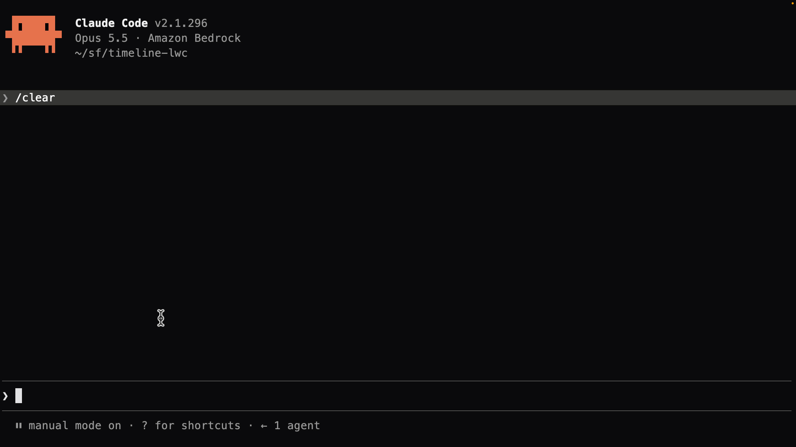

<div align="center">
	
	<h1>Salesforce Headless Band</h1>
</div>

<h4 align="center">
	<a href="#overview">Overview</a> |
	<a href="#setup">Setup</a> |
	<a href="#how-it-works">How it Works</a> |
	<a href="#faqs">FAQs</a> |
	<a href="#contributing">Contribute</a>
</h4>

<h3 align="center">
	A Claude Code mod that shows which Salesforce orgs Claude can reach, right above the prompt<br><br>
</h3>

<div align="center">
	
</div>

<br>

## Overview

> **Disclaimer:** This is a community project and not an official Salesforce product. It is not supported, endorsed, or maintained by Salesforce.

A [Claude Code mod](https://code.claude.com/docs/en/plugins/mods/overview) that shows your Salesforce default org above the prompt, with its type (scratch, developer edition, sandbox, or production) and how many days a scratch org has left. The type is a solid pill after the line's details, with production in red.

It also shows the Salesforce MCP servers you have added to Claude Code, so you can see every org Claude can reach.

| Line | Shows |
|------|-------|
| `sf › cli` | The Salesforce CLI's default org, its type, and a scratch org's days to expiry |
| `sf › mcp` (DX) | Each [Salesforce DX MCP Server](https://developer.salesforce.com/docs/atlas.en-us.sfdx_dev.meta/sfdx_dev/sfdx_dev_mcp.htm) and the orgs its `--orgs` flag allows |
| `sf › mcp` (hosted) | [Salesforce Hosted MCP servers](https://developer.salesforce.com/docs/atlas.en-us.api_meta.meta/api_meta/meta_mcp_server_eca.htm), grouped by the org they reach |

## Setup

#### Requirements

* Claude Code v2.1.287 or later, in the terminal or the Code tab of the Claude Desktop app
* The Salesforce CLI with at least one authorized org, or a Salesforce MCP server (DX or hosted) added to Claude Code

#### Try it

1. Clone this repository:
   ```bash
   git clone https://github.com/deejay-hub/sf-headless-band.git
   ```

2. Launch Claude Code in your Salesforce project with the mod loaded:
   ```bash
   cd ~/projects/my-sfdx-project
   claude --plugin-dir ~/path/to/sf-headless-band
   ```

3. Type `/sf-headless-band` to show the band — you're ready to go.

#### Optional: Load it in every session

Add the folder to `CLAUDE_CODE_PLUGIN_DIRS` in the `env` block of `~/.claude/settings.json`. Use an absolute path or one starting with `~`:

```json
{
  "env": {
    "CLAUDE_CODE_PLUGIN_DIRS": "~/path/to/sf-headless-band"
  }
}
```

#### Hide or show it

The band starts off. Type `/sf-headless-band` to show it, and again to hide it; `/sf-headless-band on` and `/sf-headless-band off` say which. The choice is kept across sessions. The `[-]` mark at the band's right edge only folds it for now.

## How it Works

### The CLI line

```text
sf › cli › timeline-lwc › speedy-1-dev-ed › expires in 30 days › [ scratch ]
```

The CLI line shows wherever a default org is set: the project's, else your global one, as a DX server's `DEFAULT_TARGET_ORG` resolves it. It names the org by alias, then its My Domain, then its type.

### Salesforce DX MCP Server

The [Salesforce DX MCP Server](https://developer.salesforce.com/docs/atlas.en-us.sfdx_dev.meta/sfdx_dev/sfdx_dev_mcp.htm) (`@salesforce/mcp`) uses the CLI's auth files. Its `--orgs` flag lists the only orgs it may reach. Each DX MCP server gets a line listing those orgs by alias, with their types:

```text
sf › cli › my-scratch › speedy-1-dev-ed › expires in 2 days › [ scratch ]
sf › mcp › ✓ salesforce-dx › my-scratch, uat › speedy-1-dev-ed, acme--uat › [ scratch ] [ sandbox ]
```

`DEFAULT_TARGET_ORG` and `DEFAULT_TARGET_DEV_HUB` show as the alias they resolve to. `ALLOW_ALL_ORGS` adds an **all orgs** pill in production red, because it can reach production. Each org the server reaches gets its own pill.

To keep MCP on the same org as the CLI, start the server with `--orgs DEFAULT_TARGET_ORG` and don't name orgs in your prompts. The `sf › mcp` line then names the same org as the `sf › cli` line.

### Salesforce Hosted MCP servers

[Hosted MCP servers](https://developer.salesforce.com/docs/atlas.en-us.api_meta.meta/api_meta/meta_mcp_server_eca.htm) are the ones you sign in to with OAuth through an External Client App. Each line lists server names and an org type:

```text
sf › mcp › ✓ metadata-experts, ✓ sobject-all › acme › [ production ]
sf › mcp › ✗ globex-sobjects › [ production ]
sf › mcp › ✗ sobject-all-uat › [ sandbox ]
```

The mod finds a hosted server by its URL, `https://api.salesforce.com/platform/mcp/<version>/[sandbox/]platform/<server>`. That holds for an `http` server and for an `mcp-remote` bridge that names the URL in its args. It reads the type from the URL: a `/sandbox/` path serves sandbox and scratch orgs, and any other path serves production.

Servers that share an External Client App's consumer key reach the same org, so they share a line. A different key means a different org and gets its own line, even when both orgs are production. Claude Code keeps the OAuth token in its own credential store, so the mod can't tell which org or user you signed in as. That's why these lines name servers, not orgs.

### The rules every line follows

* **Which servers are in use:** the copy of each server name Claude Code uses (local over project over user), from `.mcp.json` files in the folder upward, and not one you've disabled with `/mcp`.
* **Each org's type:** scratch and sandbox from the CLI auth file's flags, developer edition from a `-dev-ed` My Domain, otherwise production. A hosted server shows no type until one of its calls has carried its org's My Domain; then that names the org on its line and gives its type.
* **What a DX server reaches:** `DEFAULT_TARGET_ORG` and `DEFAULT_TARGET_DEV_HUB` resolved as the CLI does (`SF_TARGET_ORG` first, then the project's `sfdx-project.json` root, then your global config). The line takes the riskiest org's type, and `ALLOW_ALL_ORGS` counts as production.
* **The colors:** red production, blue developer edition, yellow sandbox, green scratch, gray unknown.
* **Each line names its org the same way:** what you call it, then its My Domain's name (`speedy-1-dev-ed`, `acme--uat`), then its type.
* **Connected or not:** `✓` once the session has a server's tools, `✗` until then.
* **Changes made elsewhere:** `sf config set target-org` in a terminal, an alias, or an MCP server changed in another session shows within about 3 seconds.

### Project Structure

```
sf-headless-band/
├── .claude-plugin/
│   └── plugin.json              # The plugin manifest
├── hooks/
│   ├── hooks.json               # Points Claude Code to register.tsx
│   ├── register.tsx             # Refreshes the org and draws the band
│   ├── org.ts                   # Finds the project, the default org, its type, and its expiry
│   ├── mcp.ts                   # Finds the Salesforce MCP servers in use for the folder
│   └── salesforce.ts            # Salesforce rules shared with sf-headless-config
├── types/
│   └── index.d.ts               # Declares the mod's $.state values
└── tests/                       # Tests for the org lookup, the MCP lookup, and the band
```

**`org.ts`** reads the Salesforce CLI's config, alias, and auth files to find the default org, its type, and its expiry.

**`mcp.ts`** finds hosted servers and their type, and DX MCP servers and the orgs they allow.

**`salesforce.ts`** holds the rules for which servers are in use, the orgs they reach, org types, and colors. It is kept identical to the copy in sf-headless-config, so the two mods always agree.

## FAQs

#### Does the mod call Salesforce or the MCP servers?

No. The mod reads files directly, so it never runs `sf`, never calls the MCP servers, and never touches the network.

#### What files does it read?

Salesforce CLI internals (`~/.sf/config.json`, `~/.sfdx/alias.json`, and `~/.sfdx/<username>.json`). These are not a public API, so a future CLI release could change them. It reads only the type and expiry fields from the auth files.

For MCP it reads Claude Code's own MCP config: user and local scope in `~/.claude.json` (or `$CLAUDE_CONFIG_DIR/.claude.json`), and project scope in `.mcp.json` files from the folder upward. It reads only each server's `command`, `url`, `args`, and consumer key (`oauth.clientId`, or the `client_id` in mcp-remote's `--static-oauth-client-info`), never its `headers` or any secret.

#### Why does a hosted server line name servers, not an org?

Claude Code keeps the OAuth token in its own credential store, so the mod can't tell which org or user you signed in as. Once one of the server's calls carries the org's My Domain, the line names the org and shows its type.

#### Where do the lines show?

The CLI line shows wherever a default org is set. The MCP lines show in any folder where a server is configured. Outside a project, `DEFAULT_TARGET_ORG` resolves to your global default.

#### How does it relate to sf-headless-config?

sf-headless-config is the full pane for your Salesforce MCP servers: every scope, every copy, add, edit, and delete. This band is the short version. It shows only what's in use for the folder. Each mod works without the other, and they always agree because they share `hooks/salesforce.ts`.

## Contributing

Contributions are greatly appreciated. See [CONTRIBUTING.md](CONTRIBUTING.md) for guidelines.

Check and test your changes before submitting:

```bash
claude plugin validate .
claude plugin test
```

## License

MIT
